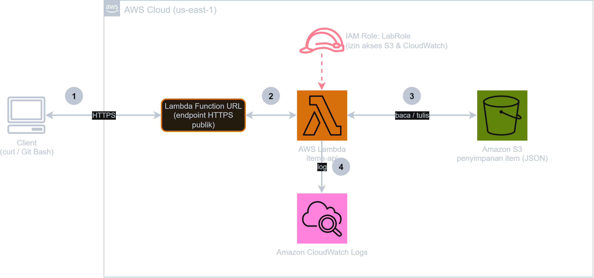

# Sistem Peminjaman Alat Kampus Serverless

* Nama: Muhammad Affandi Argya Bagaskara
* NIM: 24/538984/TK/59778

## Latar Belakang

Pencatatan peminjaman alat di kampus umumnya masih bergantung pada koordinasi dan jam layanan, sehingga tidak bisa dilakukan kapan saja. Proyek ini menyediakan API untuk menambah alat, mencatat peminjaman dan pengembalian, serta melihat status alat kapan saja, tanpa server yang harus dijalankan terus-menerus.

## Arsitektur



**Alur request**
1. Client mengirim request HTTPS (POST, GET, PUT, DELETE ke `/items`) ke Lambda Function URL dan menerima responsnya.
2. Function URL meneruskan request ke Lambda `items-api` dan mengembalikan hasilnya.
3. Lambda membaca atau menulis file JSON item di S3.
4. Lambda menulis log eksekusi ke CloudWatch Logs.

**Izin:** Lambda memakai IAM role `LabRole` untuk mengakses S3 dan CloudWatch Logs.

## Perbandingan dengan Desain Referensi

Desain referensi dari brief: API Gateway + Lambda + DynamoDB. Sandbox AWS Academy Cloud Foundations memblokir API Gateway dan DynamoDB, sehingga dua layanan itu diganti dengan layanan sejenis.

| Fungsi | Desain referensi | Desain aktual | Alasan | Konsekuensi |
|---|---|---|---|---|
| Endpoint HTTP | Amazon API Gateway | Lambda Function URL | API Gateway tidak bisa diakses di sandbox AWS Academy | Kontrol keamanan dan manajemen routing berkurang. Routing dilakukan di kode |
| Compute | AWS Lambda | AWS Lambda (satu fungsi `items-api`) | Operasi CRUD sederhana cukup ditangani satu fungsi dengan percabangan berdasarkan method dan path | Satu fungsi memegang semua route, sehingga perlu dipecah jika kode membesar |
| Penyimpanan | Amazon DynamoDB | Amazon S3 (satu file JSON per item) | DynamoDB tidak bisa dipakai di sandbox. S3 tersedia dan cukup untuk satu entitas | S3 bukan database, sehingga tidak ada query atau filter, dan tidak ada operasi atomik |
| Log | CloudWatch Logs | CloudWatch Logs | Sesuai referensi | Tidak ada |
| Izin | IAM role khusus | `LabRole` bawaan sandbox | Sandbox tidak mengizinkan pembuatan role | Izin lebih luas dari yang dibutuhkan |

## Data Entity

Item, disimpan di S3 sebagai `items/{itemId}.json`.

| Field | Tipe | Keterangan |
|---|---|---|
| itemId | String | ID unik (UUID), menjadi bagian nama file |
| itemName | String | Nama alat |
| status | String | `AVAILABLE` atau `BORROWED` |
| borrowerName | String / null | Nama peminjam, `null` jika AVAILABLE |
| borrowerNim | String / null | NIM peminjam, `null` jika AVAILABLE |
| borrowedAt | String / null | Waktu pinjam, `null` jika AVAILABLE |
| dueDate | String / null | Batas pengembalian, `null` jika AVAILABLE |

## Endpoint CRUD

| Method | Path | Fungsi | Response sukses |
|---|---|---|---|
| POST | `/items` | Menambah alat baru (status awal AVAILABLE) | 201 + data item |
| GET | `/items` | Melihat daftar alat beserta statusnya | 200 + daftar item |
| PUT | `/items/{id}` | Mengubah data alat, termasuk meminjam dan mengembalikan | 200 + data terbaru |
| DELETE | `/items/{id}` | Menghapus alat dari daftar | 204 |

Response error: 400 (body tidak valid), 404 (item tidak ditemukan), 409 (item sedang dipinjam).

Contoh:

```bash
URL=https://<function-url>.lambda-url.us-east-1.on.aws

# tambah alat
curl -X POST $URL/items -H "Content-Type: application/json" -d '{"itemName":"Multimeter"}'

# pinjam alat
curl -X PUT $URL/items/<itemId> -H "Content-Type: application/json" \
  -d '{"status":"BORROWED","borrowerName":"Aga","borrowerNim":"123456"}'
```

## Struktur Repo

```
lambda/index.mjs      kode Lambda (satu handler untuk semua route)
test/curl-tests.sh    skrip uji CRUD end-to-end
docs/architecture.png diagram arsitektur
docs/evidence/        screenshot bukti pengujian di AWS
```

## Deployment Plan

Semua langkah dilakukan manual lewat AWS Console di sandbox (region `us-east-1`). Deployment otomatis dari GitHub tidak dipakai karena IAM di sandbox read-only dan kredensialnya sementara.

1. **S3:** buat bucket (contoh `bucket-aga-peminjaman-serverless`). Biarkan *Block all public access* aktif.
2. **Lambda:** buat fungsi `items-api` dengan runtime Node.js 26.x. Pada *Change default execution role*, pilih *Use an existing role* dan pilih `LabRole`. Atur timeout 15 detik (memori tetap 128 MB).
3. **Function URL:** aktifkan di Configuration → Function URL dengan auth type `NONE` dan invoke mode `BUFFERED`. Console otomatis membuat dua statement resource-based policy (`InvokeFunctionUrl` dan `InvokeFunction`); cek di Configuration → Permissions.
4. **Kode:** tempel isi `lambda/index.mjs` ke tab Code, lalu klik Deploy.
5. **Environment variable:** tambahkan `BUCKET_NAME` berisi nama bucket dari langkah 1.
6. **Uji:** jalankan `bash test/curl-tests.sh <Function URL>`.

Semua resource di sandbox terhapus saat sesi lab berakhir, jadi langkah di atas diulang setiap sesi baru.

## Pengujian

`test/curl-tests.sh` menjalankan urutan berikut: POST alat baru, GET daftar, PUT meminjam alat (status `BORROWED`), PUT meminjam lagi (harus 409), lalu DELETE (harus 204). Hasil uji dan screenshot AWS ada di `docs/evidence/`.

## Keamanan dan Keterbatasan

- **Endpoint publik tanpa autentikasi.** Function URL memakai auth type `NONE`, jadi siapa pun yang tahu URL-nya bisa menambah, mengubah, atau menghapus data.
- **Bucket S3 privat.** Block Public Access aktif, sehingga hanya Lambda yang mengakses data lewat `LabRole`.
- **`LabRole` berizin luas.** Ini batasan sandbox. Di lingkungan nyata dipakai role dengan prinsip least privilege.
- **Cek konflik tidak atomik.** Pengecekan 409 membaca lalu menulis dalam dua langkah. Dua request bersamaan bisa sama-sama lolos, dan yang terakhir menulis yang menang (last write wins).
- **Daftar item lambat saat data banyak.** `GET /items` butuh 1 panggilan list ke S3 lalu 1 panggilan baca per item.
- **Cold start.** Request pertama setelah idle lebih lambat (terukur Init Duration 388 ms).
- **Memori hampir penuh.** Pemakaian tercatat 112 MB dari 128 MB.

## Rencana Pengembangan

- Menambah entitas Loan untuk mencatat riwayat peminjaman.
- Mengganti penyimpanan ke DynamoDB (atau RDS bila perlu SQL) agar bisa query dan memakai kondisi atomik.
- Menambah API Gateway dengan autentikasi dan throttling.
- Memakai IAM role dengan izin minimum.
